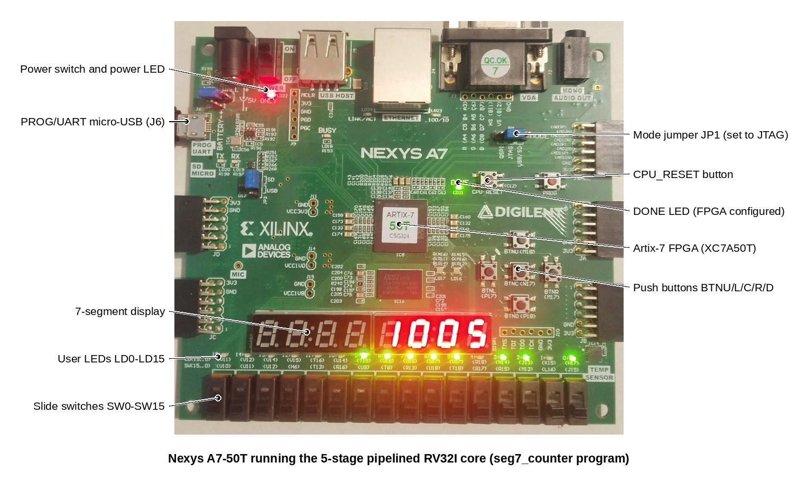

<!-- GENERATED FILE - DO NOT EDIT. Source: tools/make_readme.py -->

# nexys_rv32

Design and Instruction-Level Verification of Multi-Cycle and Pipelined RISC-V Processors on an Artix-7 FPGA.

Two RV32I cores (with machine-mode Zicsr, a timer interrupt and Zifencei) in Verilog-2001 for the Digilent Nexys A7-50T (XC7A50T), one SoC, a UART bootloader in a case-statement boot ROM, a C runtime and a regression that checks every retired instruction against a Python golden model.

Author: Saman Fuyal, Department of Electrical and Electronics Engineering, Kathmandu University.



## Status

| Item | State | Evidence |
|---|---|---|
| RTL: multi-cycle core, 5-stage pipeline, SoC, peripherals | done | Verilog-2001, `rtl/` |
| Static checks (rule checker, Verilator -Wall, Yosys no-latch proof, Vivado Tcl check) | done | 9 / 9 pass |
| Regression (unit, directed, riscv-tests, arch-test, random lockstep, C programs) | done | 854 / 854 runs pass, 0 failed (2026-11-02 14:59:46; Verilator 5.052 2026-09-05 rev v5.052, Icarus Verilog version 12.0 (stable) (v12_0)) |
| Code coverage | done | 98.0 % of RTL lines hit (Verilator coverage build) |
| Fault injection | done | 16 of 16 injected bugs caught |
| Benchmarks in RTL simulation | done | Dhrystone 0.396 / 0.983 DMIPS/MHz, CoreMark 0.448 / 0.973 per MHz (multi-cycle / pipeline) |
| Resource estimate (Yosys) | done | SoC 2369 / 2624 LUT, 1122 / 1554 FF |
| Vivado 2018.2 build: utilisation and timing | done | Fmax 53.9 / 56.4 MHz, LUT 2132 / 2288 |
| Board bring-up and on-board benchmarks | done | Dhrystone 0.396 / 0.983 DMIPS/MHz, CoreMark 0.448 / 0.973 per MHz at 50 MHz (multi-cycle / pipeline) |
| On-board self-test (UART output vs golden model) | done | mc: 158 of 158 programs identical, 489628 bytes; pipe: 158 of 158 programs identical, 489628 bytes |
| Paper, IEEE conference format, 6 pages | done | [`docs/paper/`](docs/paper/) (PDF and Word) |

Full numbers: [`docs/RESULTS.md`](docs/RESULTS.md). Decisions and open items: [`docs/STATUS.md`](docs/STATUS.md).

## Memory map

| Region | Base | Size | Execute | Write |
|---|---|---|---|---|
| bootrom | `0x00000000` | 2 KB | yes | no |
| ram | `0x80000000` | 64 KB | yes | yes |
| io | `0x40000000` | 4 KB | no | yes |

Anything else raises an access fault. Peripheral and CSR tables: [`docs/generated/memory_map.md`](docs/generated/memory_map.md).

## Board controls

| Control | Function |
|---|---|
| CPU_RESET (red button) | Resets the SoC; the bootloader starts and shows `B0070001` |
| SW15 up at reset | Bootloader skips the host and re-runs the program already in RAM |
| SW0-SW15 | Read by programs (`switches_leds` mirrors them on the LEDs) |
| BTNC/U/L/R/D | Read by programs; `seg7_counter`: pause, reset, count down, count up, stop |
| LED0-LED15 | Written by programs (`timer_irq` blinks LED0 at 1 Hz) |
| 7-segment display | 8 hex digits written by programs |
| USB-UART (J6) | 115200 baud, 8N1: bootloader and program console |

## Quick start (Windows)

Every command, in order, with what it does: [`COMMANDS.md`](COMMANDS.md). Board checklist: [`docs/BRINGUP.md`](docs/BRINGUP.md).

Tools: Python 3.10 or newer, Icarus Verilog 12, Vivado 2018.2, and the xPack RISC-V GCC 14.2.0-3 (only to rebuild the software; `sw/prebuilt/` has every program ready-made). From the project folder (the path must not contain spaces):

```bat
py -m pip install matplotlib pyserial
preflight.bat
run_sim.bat --quick
```

The last line ends with `ALL PASS`. The full regression (Verilator, Yosys and the long tests) runs in WSL or Linux with `bash wsl_regression.sh`. Then build both bitstreams:

```bat
fpga\build.bat pipe
fpga\build.bat mc
update_docs.bat
```

With the board on (JP1 on JTAG, cable in J6, SW15 down):

```bat
board_day.bat pipe
```

It programs the FPGA, loads `sw\prebuilt\hello.elf`, runs the benchmarks and the on-board self-test (158 programs whose UART output must match the golden model byte for byte) and updates the results. The tools find the COM port themselves (`--port auto`).

## Folder layout

| Folder | Contents |
|---|---|
| `params.json` | Single source of truth: clock, memory map, peripherals, CSRs |
| `rtl/` | Verilog: `core/` (both cores and shared units), `soc/`, `periph/`, `gen/` (generated) |
| `fpga/` | FPGA top, constraints, Vivado Tcl and `.bat` scripts |
| `sim/` | Testbench, regression runner, unit/directed tests, riscv-tests and arch-test ports |
| `model/` | Golden ISS, lockstep compare, random test generator, software board model |
| `sw/` | Runtime, bootloader, programs, benchmarks, build script, Makefile; `sw/prebuilt/` ready-made programs |
| `host/` | UART loader, on-board benchmark and on-board self-test scripts |
| `tools/` | Generators, static checks, coverage, fault injection, figures |
| `docs/` | Paper, board checklist, design decisions, results, figures, Vivado RTL schematics |
| `*.bat`, `*.sh` (top) | `preflight.bat`, `board_day.bat`, `update_docs.bat`, `run_sim.bat`; `wsl_regression.sh` |
| `results/` | Tool output that every document reads |

## Licences of included third-party code

`sim/riscv_tests/upstream`, `sim/arch_test/upstream`, `sw/third_party/coremark` and `sw/third_party/dhrystone` keep their original licence files.
